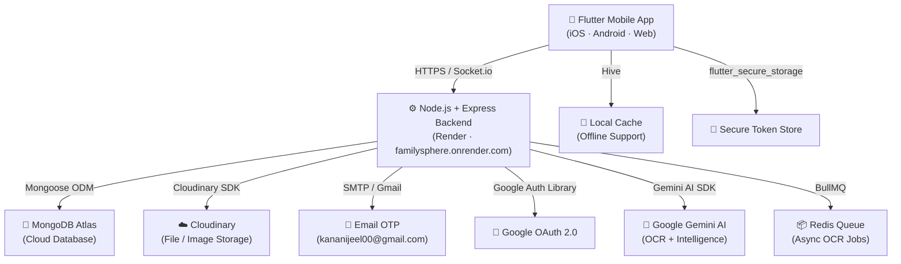
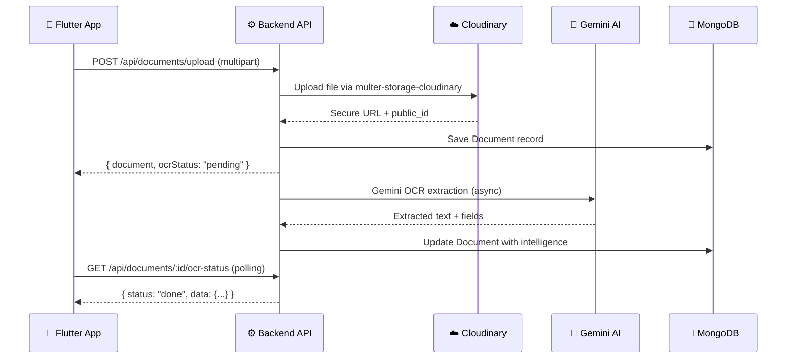

# 🌐 FamilySphere — Project Overview & Demonstration Guide

> **Status:** ✅ Production-Ready | All credentials configured | Deployed on Render

---

## 🏗️ Architecture at a Glance



---

## 🚀 Production Deployment

| Service | URL / Endpoint |
|---------|---------------|
| **Backend API** | `https://familysphere.onrender.com` |
| **Health Check** | `https://familysphere.onrender.com/api/health` |
| **Ping** | `https://familysphere.onrender.com/ping` |
| **Flutter Target** | `_isProduction = true` → points to Render URL |

---

## 📦 Tech Stack

### Backend — `d:\FamilySphere\backend`
| Layer | Technology |
|-------|-----------|
| Runtime | **Node.js** with **TypeScript** |
| Framework | **Express v5** |
| Database | **MongoDB Atlas** via Mongoose v9 |
| Auth | **JWT** (30-day tokens) + **Google OAuth 2.0** |
| File Storage | **Cloudinary** (documents, profile pictures) |
| Email | **Nodemailer** (SMTP via Gmail) + **Resend** |
| Real-time | **Socket.io** |
| Job Queue | **BullMQ** (Redis-backed OCR queue) |
| AI / OCR | **Google Gemini AI** + **Tesseract.js** (English + Hindi) |
| Security | **Helmet**, **bcryptjs**, CORS, rate limiting |
| Scheduling | **node-cron** (event reminders, cleanup) |

### Mobile — `d:\FamilySphere\mobile\familysphere_app`
| Layer | Technology |
|-------|-----------|
| Framework | **Flutter** (Dart SDK ≥3.2) |
| State Management | **Riverpod v2** |
| Local Cache | **Hive** |
| Networking | **Dio** + **http** |
| Secure Storage | **flutter_secure_storage** |
| UI Fonts | **Google Fonts** |
| Charts | **fl_chart** |
| PDF | **syncfusion_flutter_pdf**, **flutter_pdfview** |
| QR | **qr_flutter** + **mobile_scanner** |
| Camera / OCR | **google_mlkit_text_recognition**, **google_mlkit_document_scanner** |
| Real-time | **socket_io_client** |
| Deep Links | **app_links** |
| Notifications | **flutter_local_notifications** |

---

## 🔑 Credentials & Configuration

### Backend Environment Variables (`.env`)
| Key | Status |
|-----|--------|
| `MONGO_URI` | ✅ MongoDB Atlas connected |
| `JWT_SECRET` | ✅ Set |
| `GOOGLE_CLIENT_ID` | ✅ Set |
| `CLOUDINARY_CLOUD_NAME/KEY/SECRET` | ✅ Set |
| `SMTP_HOST / SMTP_USER / SMTP_PASS` | ✅ Gmail SMTP ready |
| `OTP_SECRET` | ✅ Set |
| `GEMINI_API_KEY` | ✅ Set |
| `REDIS_URL` | ✅ Redis Cloud (bypassed for demo) |
| `PORT` | 5000 |

### Flutter Config
| Config | Value |
|--------|-------|
| Production URL | `https://familysphere.onrender.com` |
| Google OAuth Web Client ID | `806870586097-qlgq0fm3c03ink7khc8hfe1n52mig2tn.apps.googleusercontent.com` |
| Mode | `_isProduction = true` |

---

## 🗂️ Feature Modules

### 🔒 Authentication
- Email + Password registration with **Email OTP verification** (6-digit, 10-min expiry)
- **Google Sign-In** (OAuth 2.0 ID token flow)
- **JWT** tokens (30-day expiry, revocable via `tokenVersion`)
- Profile management with Cloudinary avatar upload
- Token invalidation on logout

### 👨‍👩‍👧‍👦 Family Management
- Create / join a family (invite code or QR)
- Role-based access: `admin` / `member`
- Family activity log
- QR-code invite links with expiry & max-use limits
- Family settings (rename, leave, delete)

### 📄 Documents
- Upload documents (images / PDFs) to Cloudinary
- **AI-powered OCR** extraction (Gemini + Tesseract, English & Hindi)
- Category-based organisation (Personal, Shared, Private Locker)
- Folder structure per member
- Async OCR job queue (BullMQ/Redis) with sync fallback
- Recent documents view
- Admin engine dashboard for queue monitoring

### 🧪 Document Lab (15+ Tools)
| Tool | Description |
|------|-------------|
| Merge PDF | Combine multiple PDFs |
| Split PDF | Extract pages |
| Image → PDF | Convert images to PDF |
| Protect PDF | Password-protect |
| Unlock PDF | Remove password |
| Compress PDF | Reduce file size |
| Rotate PDF | Rotate pages |
| PDF → Text | Extract text |
| Crop Image | Crop & trim |
| Image Resize | Resize dimensions |
| Image Compress | Reduce image size |
| Image Convert | Format conversion |
| BG Remover | Background removal |
| File Converter | Format switching |
| Zip/Unzip | Archive manager |
| Batch Rename | Bulk file rename |
| Preview & Share | Preview before sharing |

### 🗓️ Events & Timeline
- Create/edit family events with reminders
- AI-powered event generator from document context
- Cron-based reminder notifications (node-cron)
- Timeline view

### 💬 Family Chat
- Real-time messaging via **Socket.io**
- Offline queue (Hive) with auto-sync on reconnect
- Exponential backoff retry (15s → 120s max)

### 🏠 Family Hub
- Social feed (posts with images)
- Add/view posts with Cloudinary media

### 🔐 Private Vault
- Encrypted private document locker per user
- Separate folder structure

### 🤖 Intelligence / AI
- Document intelligence extraction (key fields, summaries)
- `IntelligenceFact` model for structured facts
- Gemini AI hybrid OCR pipeline

### 🔔 Notifications
- **flutter_local_notifications** for push alerts
- Deep link handling (`app_links`) for invite/join flows

---

## 📡 API Endpoints Summary

| Module | Prefix | Key Routes |
|--------|--------|-----------|
| Auth | `/api/auth` | `POST /register`, `/login`, `/logout`, `/google`, `/send-email-otp`, `/verify-email-otp`, `GET /me`, `PUT /profile` |
| Family | `/api/families` | `POST /`, `GET /:id`, `PUT`, invite flows |
| Documents | `/api/documents` | `POST /upload`, `GET /`, `DELETE /delete`, `GET /:id/ocr-status` |
| Vault | `/api/vault` | Private document endpoints |
| Events | `/api/events` | CRUD + reminder triggers |
| Admin | `/api/admin` | Queue stats, engine dashboard |
| Intelligence | `/api/intelligence` | AI fact extraction |
| Hub | `/api/hub` | Posts & family feed |
| Chat | `/api/chat` | Message history |
| Health | `/api/health` | Mongo + Redis status |

---

## 🏃 Running the Project

### Local Development
```bat
:: Start Redis + Backend (auto-detects WiFi IP for physical device)
start-dev.bat

:: Start Flutter (physical Android device)
flutter-local.bat
```

### Production (Already Live)
```bash
# Backend is deployed on Render — no action needed
# Flutter app already points to: https://familysphere.onrender.com
# Just run: flutter run (or build APK)
flutter run --release
```

---

## 🔄 Data Flow — Document Upload (Example)



---

## 🗃️ Database Models

| Model | Purpose |
|-------|---------|
| `User` | Auth, profile, familyId, role, tokenVersion |
| `Family` | Name, memberIds, createdBy, inviteCode |
| `Document` | File metadata, Cloudinary URLs, OCR data |
| `DocumentIntelligence` | Extracted AI facts per document |
| `IntelligenceFact` | Structured key-value facts |
| `Event` | Calendar events with reminders |
| `EmailOtp` | OTP verification records |
| `Invite` | QR/link invites with expiry |
| `FamilyActivity` | Audit log of family actions |
| `ChatMessage` | Real-time chat history |
| `Post` | Family Hub feed posts |
| `VaultFolder` | Private locker folder structure |
| `Reminder` | Cron-triggered reminders |

---

## 🛡️ Security Highlights

- **JWT** with `tokenVersion` (server-side invalidation on logout)
- **bcryptjs** password hashing
- **Helmet** HTTP security headers
- **OTP** rate limiting (30s cooldown, 5 attempt lockout)
- **Email OTP** hashed with SHA-256 (`email:code:secret`)
- **CORS** configured
- Cloudinary signed uploads
- Sensitive keys only in `.env` (not committed)
- Security Audit Report available: `SECURITY_AUDIT_REPORT.md`

---

## 📊 Real-time Capabilities

| Feature | Technology |
|---------|-----------|
| Chat | Socket.io bidirectional |
| Network Monitoring | `connectivity_plus` |
| Auto-sync on reconnect | Riverpod + Timer (exponential backoff) |
| OCR job status | Polling `/api/documents/:id/ocr-status` |
| Queue health | `/api/health/queues` |

---

> **Demo Note:** Redis OCR queue is bypassed (`appState.ocrQueueEnabled = false`) for stable demonstration — documents are processed synchronously via direct Gemini AI calls. Re-enable by uncommenting the Redis check in `server.ts`.
